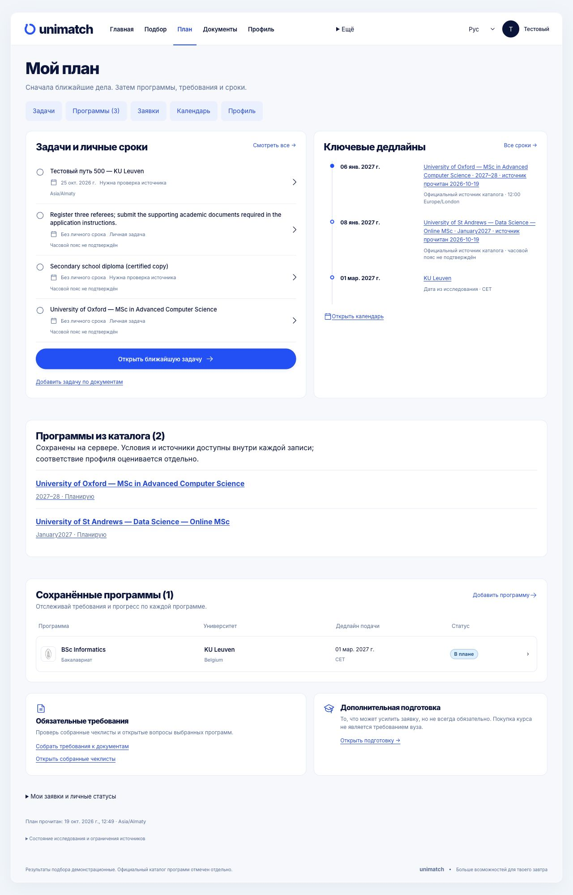
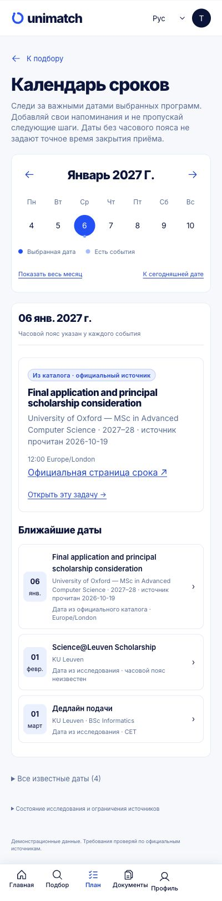

# Official programmes and connected plan — 19 October 2026

**PARTIAL DATA DELIVERY / FULL 500-INSTITUTION REQUEST OPEN.** The UI path is implemented and locally exercised. The directory still contains 500 institution identities, while the programme library currently publishes **14 reviewed records at 9 institutions: 7 bachelor and 7 master records**. Twelve records allow an external personal-plan route; one is internal-only and one closed for the cited intake. Many fields remain explicitly unknown. None of the 500 institutions is claimed comprehensively covered.

The catalogue card now contains programme-specific requirements, fee units and population/year, funding information, dated official links, document actions and remaining questions. Confirming a programme creates a durable, case-owned personal application through the existing G3 journal. It does not create a synthetic research result or an applicant eligibility assessment. Document tasks are personal tasks linked to that application with source URLs, not server-verified source-reference bindings. Official source deadlines appear separately from personal dates. Multi-intake courses require choosing an intake; the Plan/calendar project only that intake’s dates.

Saved source versions remain archived and addressable. Editing personal notes preserves the source snapshot; changing university, programme, route or intake outside the known snapshot retires its projection. Pending unknown commands block replacement writes. A known CAS rejection remains in history but permits a new explicitly reviewed command against the refreshed revision. Case switches fence late feedback and redirects.

## Coverage and sources

A finite, robot-respecting, single-attempt discovery pass visited 500 imported institution identities, making 1526 reads. It produced 127 UNREVIEWED candidates, including admissions tests, faculty pages, news, integrated undergraduate MEng routes and wrong-campus matches. They were not bulk-published as programmes. No HTTP429 occurred in this pass. Robots exclusions, access errors, blocked URLs and missing current programme facts remain gaps, not proof that courses or scholarships are absent. Discovery alone qualified zero programmes.

[COVERAGE.csv](COVERAGE.csv) records all 1000 institution/degree slots, with no fabricated completion. [PROGRAMME_FIELDS.csv](PROGRAMME_FIELDS.csv) shows fields and gaps for the 14 published records. [DISCOVERY_SUMMARY.json](DISCOVERY_SUMMARY.json) reports access outcomes. [RAW_SOURCE_INDEX.json](RAW_SOURCE_INDEX.json) pins locally retained public HTML; raw pages are not copied into Git. Four initial records use actual web-page reads without a saved raw-body receipt. Ten further records are based on nine exact saved official bodies. The method is visible in each source record; do not conflate those evidence types.

Lancaster University’s UK identity and Texas A&M College Station had wrong-campus source sites in the imported directory. The seed, offline overrides and local identity images were corrected using official primary sites. Earlier discovery candidates from Lancaster Ghana/TAMIU remain quarantined. Existing500 local selected images still verify; the chosen breakdown is now490 site icons,2 emblems,8 institutional logos, not500 full brand kits.

## Observed user path and checks

In the owned synthetic profile B, Oxford MSc was explicitly saved, appeared in Plan, created a linked personal document task, retained a personal note after reload and exposed the exact source deadline with time and timezone. The source-return keyboard action opened the archived version. St Andrews January2027 was then saved and retained after reload, with only8January2027 projected. MIT’s internal route has no external-create action. The original profile A was restored; B’s exact application link was fenced there. Screenshots and [NATIVE_OBSERVATIONS.json](NATIVE_OBSERVATIONS.json) state the observed scope and limitations. No actual submission or upload occurred.

Final full frontend:1049tests/111files PASS; production build with TypeScript PASS; lint0errors/9inherited warnings. The >500kB chunk warning remains. Focused catalogue backend53PASS with1inherited warning; full backend/mypy/auth not rerun. The two identity corrections were imported only into the owned synthetic DB:500seed/501total; all36non-catalogue tables had equal hashes during that import, before separate native test writes. No schema or backend application logic changed. The all-record contract check verifies each external published plan fits the existing server validator and note bounds.

## Remaining work

The request to populate both degree levels across all500 universities is **not complete**. Most institutions have no published programme records; several published records lack confirmed costs, scholarships or exact dates. Continue editorial qualification of official programme/admissions/fee/funding pages, with intake and applicant-category boundaries, and add only supported facts. Some sites require another authorized official information route because of robots/access barriers; do not bypass them or infer missing data. The public data task did not resume historical provider/model/security/heldout queues, real expert pilots or production deployment. Platform/release acceptance remains open.

