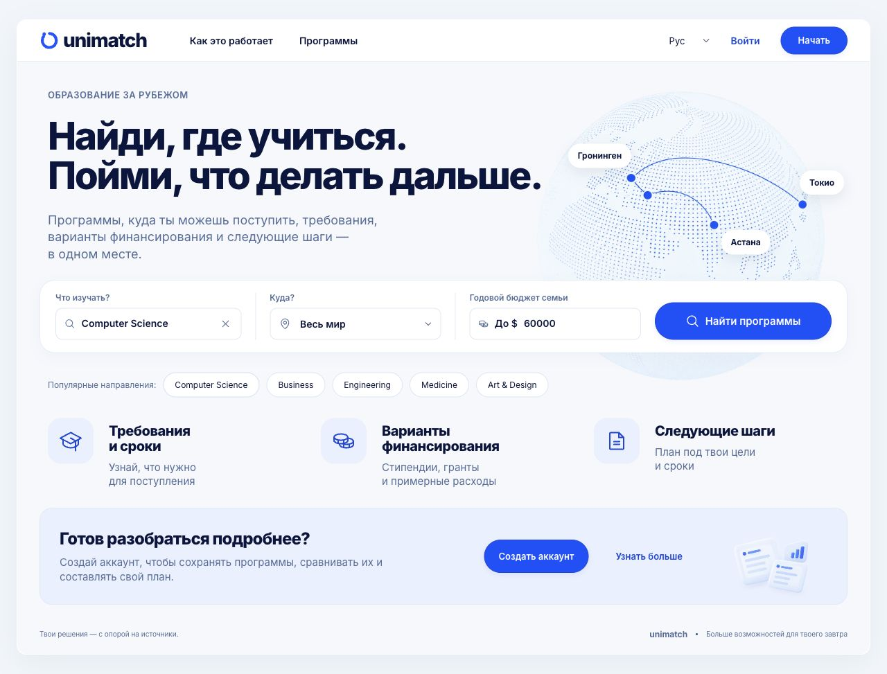
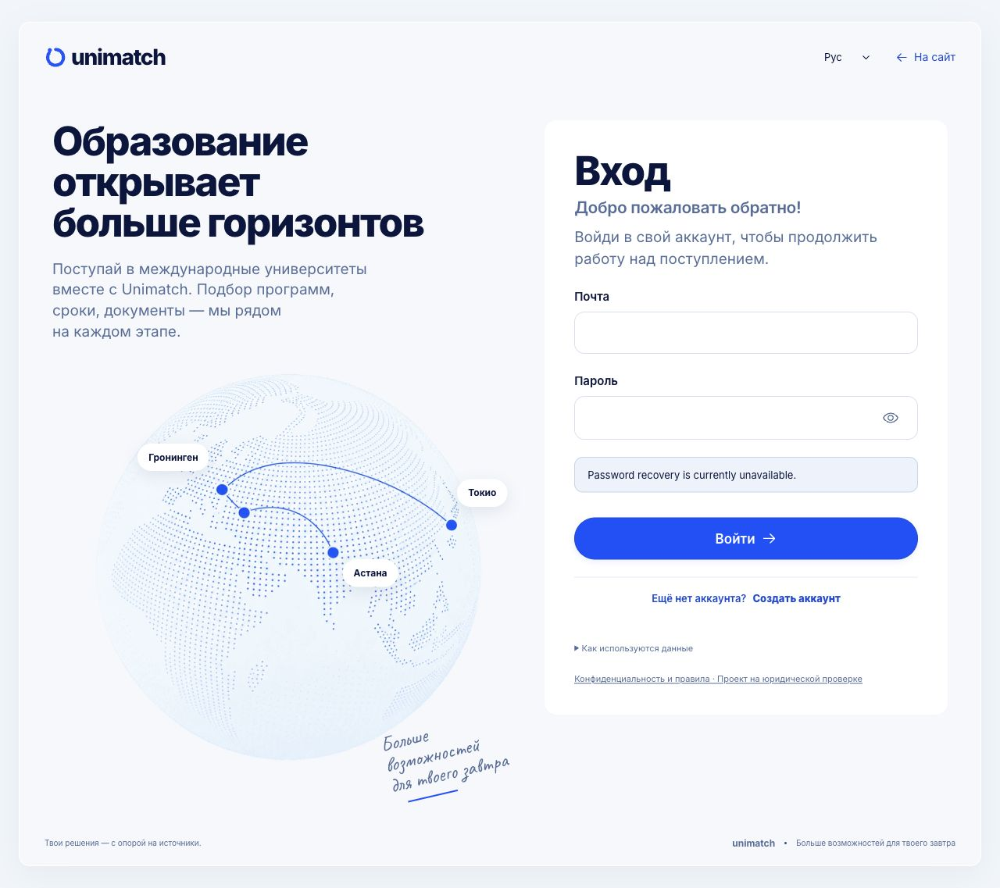

# Public deployment — 19 October 2026

Deployed the owner-requested current app to **https://ashyq-apply-alisher.fly.dev/**. Fly release7 is complete; both existing app and worker machines are started on immutable image `sha256:02afeab8faae76166dee61777552ae0fc7557cb5ec6ad9ff29a661c2d87a1bec`. Source is Git6693547306a47e27e74a797099323ae34c848921. The build adds only a public deployment.json receipt to the Git snapshot. No local synthetic database, profiles, environment files or secrets were uploaded.

The pre-deployment full Managed Postgres backup20261019-081721F completed08:17:29UTC. Nine forward migrations advanced d8e412c6a901 to a1b26e902028 before switching the app. Reviewed upgrades add tables/columns and broaden action checks; no table/column deletion or user data replacement in those upgrade functions. A schema rollback was not attempted. Old image is retained in DEPLOYMENT.json for operational recovery; a downgrade would need separate compatibility analysis.

The idempotent production catalogue import reports500seed records/501institutions/0new observations. The public frontend carries14 editorial programme records at9institutions, with unknown fields and full500programme coverage explicitly incomplete. Authentication and secure-cookie/provider/robots settings, existing secrets, app/worker resource counts and password-reset-off setting were retained. No provider/model/evaluation/search/reset probe or actual university submission was run.

Public HTTPS checks: homepage200, deployment receipt200 with exact source commit, health200/databaseok, auth status200/enabled/anonymous, entry JavaScript and CSS200. Anonymous catalogue access401 as expected. Native IAB observed the new Russian homepage and sign-in screen; no credential entry, account creation or production applicant writes. A logged-in production profile-to-application journey was not executed. Prior local frontend1049 checks remain source-bound evidence, not a substitute for this missing production acceptance.

Fly CLI's final text warns that there is no public/private IP, despite the existing hostname resolving and serving both native-browser and direct HTTPS checks successfully; no new public IP was allocated. No new hosting account or plan purchase occurred. Overall programme-data, search-quality, legal/security and platform acceptance remain OPEN. All historical stopped queues remain stopped.

