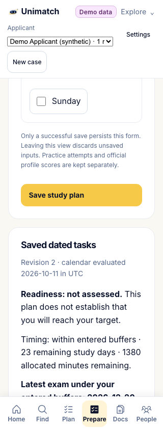
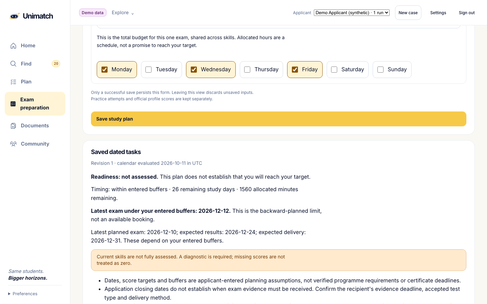

# Unimatch: план подготовки от дедлайна

11 октября 2026. **Рабочий календарь реализован и проверен локально. Полный курс и production-выпуск ещё не завершены.** Код: `task/deadline-preparation`, проверенный executable `005ac46b9cf9bd1d72b97b6a3cef7cd538ea4ed4`. Зависит от стартовой подготовки PR82.

## Что получает ученик

1. Вводит срок получения сертификата учреждением, экзамен, цели по каждому навыку и датированные текущие баллы. Срок заявки отдельно: он не устанавливает автоматически срок получения результата.
2. Указывает первую попытку, при необходимости пересдачу, ожидание результата, доставку и запас. Эти величины — его плановые предположения; место на экзамене и официальный срок доставки система не подтверждает.
3. Видит последнюю дату экзамена, которая помещается в его буферы: **срок сертификата − ожидание результата − доставка − запас**. Если введённая попытка позднее, календарь показывает риск и сохраняет поздние события.
4. Получает задания по конкретным датам с учётом выбранных дней, недельного времени и пробелов в навыках. Отсутствующие компоненты требуют диагностики; старую оценку нужно обновить. Приоритет навыка зависит от текущих и целевых баллов.
5. Сохраняет план и отметки в кейсе, восстанавливает после обновления и повторного входа. Изменение структуры требует явного сброса отметок; старая вкладка получает конфликт вместо автоматической перезаписи.

IELTS учитывает overall и Listening/Reading/Writing/Speaking отдельно; SAT — total и Math/Reading & Writing. Сейчас один активный IELTS/SAT-план на кейс. Учебные попытки и отметки не меняют официальные сертификаты в профиле.

## Что исправлено и проверено

- Неполная последняя неделя не переносит весь недельный бюджет в один день. Нагрузка распределена по выбранным дням, с пределом180 минут в день; неиспользованный резерв не сжимается. В день экзамена учебных задач нет.
- Сохранённые прошедшие задания не исчезают при смене даты. Более свежую исходную оценку можно внести после начала подготовки; будущая оценка отклоняется. Недостающие баллы не становятся нулём.
- Запись доступна в начавшийся оплаченный срок, в том числе при исчерпанной квоте поиска. Квота и исследование не меняются. История остаётся для чтения после срока; чужие кейсы недоступны.
- Сохранение подтверждается сервером. Ошибка сохраняет ввод;409 требует успешного чтения свежей версии и явного просмотра перед новым сохранением. Двойная отправка не создаёт повторное действие.
- Экспорт включает план. Удаление кейса удаляет его календарь; модель использует также ORM cascade для существующего удаления аккаунта. Отдельная конкурентная HTTP-гонка и аккаунт с этим новым календарём не проверялись как самостоятельные браузерные сценарии.

## Фактическая локальная приёмка

| Проверка | Результат |
|---|---|
| Ruff/check, format, mypy, frontend typecheck/lint/build |7 шагов PASS; lint0 ошибок/5 предупреждений о refs |
| Frontend unit |482 уникальных PASS в55 наборах |
| Backend SQLite |4773 уникальных PASS,0 failure/error/skip; coverage95,488% |
| Backend PostgreSQL |4773 уникальных PASS,0 failure/error/skip; coverage95,482% |
| Сохранение прежних проверок |Все4682 прежних backend IDs сохранены; добавлено51 pure +40 API; наборы обеих БД совпадают |
| Миграция |Один head `a9e5c14d2021` после `f1a2b3c4d511`; upgrade/downgrade и unique/FK/revision проверены |
| Native Demo браузер |95 PASS +1 прежний пропуск mobile Community; два новых сценария прошли в обеих конфигурациях |
| Native Auth браузер |7 PASS; исходная практика и календарь восстановлены во втором вошедшем сеансе |
| Мобильный экран |320/390: нет горизонтального переполнения; кнопка сохранения достижима, без принудительного клика |
| Demo seed |Свежая временная база: Groningen первым, UBC в OUT_OF_BUDGET |
| Сеть/исходники/процессы |Backend исходники неизменны, guards и OS probes пройдены, временные БД удалены; браузер только собственный localhost, source401 неизменны, порты освобождены |

Backend42 предупреждения в каждой фазе сохранены в сырых логах; они не объявлены устранёнными. Первые ошибки strict TypeScript и JSDOM-query закрытых details сохранены. Исправлены явной проверкой отсутствующего score и точной проверкой14 ближайших/4 сохранённых задач с настоящим открытием disclosure; тесты и конфигурация не ослаблены. Первоначальная isolated50PASS/1FAIL по неполной неделе также сохранена;51 новый pure-case прошёл после исправления.

Полные исходные квитанции: [backend](evidence/deadline-preparation-2026-10-11/evidence/backend-full/20261011T145907489813Z/result.json), [static/frontend](evidence/deadline-preparation-2026-10-11/evidence/static-frontend-accepted/result.json), [Demo/Auth](evidence/deadline-preparation-2026-10-11/evidence/e2e-terminal.json), [root acceptance](evidence/deadline-preparation-2026-10-11/evidence/ROOT_ACCEPTANCE.json), [INDEX](evidence/deadline-preparation-2026-10-11/INDEX.json). Независимые статические и сохранённые terminal review включены в audits; reviewer не запускал эти gates.

## Видимые состояния

Синтетический локальный кейс, введённые даты и цели. Скриншоты подтверждают вид интерфейса, а сохранение/конфликт/повторный вход проверены отдельными native assertions. Кадр конфликта показывает нижнюю заблокированную область, не весь верхний prompt.

## Что нужно для всей цели

Доступны только три оригинальных вводных занятия. Полные IELTS/SAT-курсы, диагностика и надёжная проверка Writing/Speaking ещё требуются. Другие навыки и полные пробные экзамены в календаре пока требуют подходящих внешних материалов и проверки. Календарь не устанавливает время достижения нужного балла; это требует отдельной оценки и результатов ученика.

Дальше: связывать каждый минимум и срок с актуальной конкретной программой; полноценные программы подготовки и обратная связь; несколько экзаменов и следующие каталоги; оформление новой подписки и проверенный production-выпуск. Цены не утверждены. Опубликованные сроки экзаменов разобраны в [official timing](evidence/deadline-preparation-2026-10-11/audits/official-timing.md): выпуск результата, отправка и получение различаются, универсальный buffer не подставлен.

Изменения применены в свою зависимую ветку и локально проверены. Main, production, полнота живого поиска и достижения учеников этой работой не подтверждены; прежние STOP/UNSCORED и отложенные150 вузов не возобновлялись.
