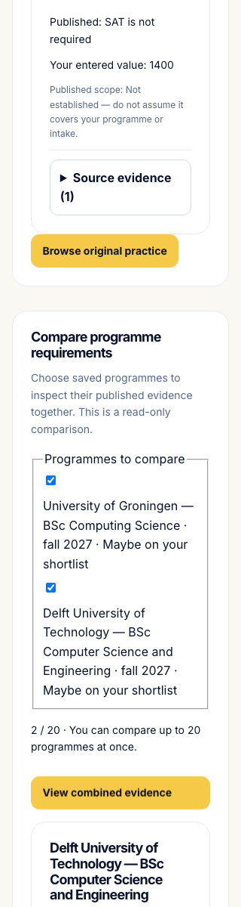
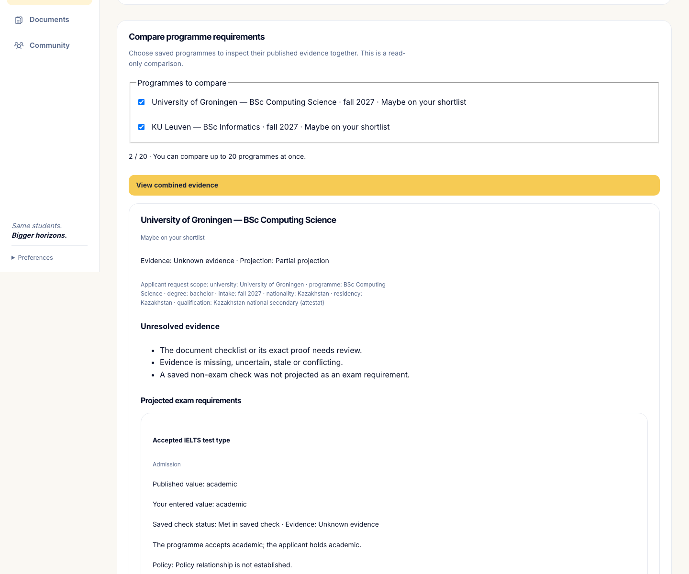

# Unimatch — сравнение требований нескольких программ

12 октября 2026, Asia/Almaty. **LOCAL_ENGINEERING_ACCEPTED · [Draft PR #86](https://github.com/wpalish/ashyq-apply/pull/86) для review · main/production/search-quality не приняты.**

## Исходная проблема и результат изменения

Подготовка была связана с требованиями одной программы. Теперь пользователь явно выбирает от 1 до 20 своих сохранённых программ со статусом approved/maybe и получает сравнение их требований. Для каждой программы остаются собственные проверки, область применения, источники, конфликтующие сведения, актуальность и пробелы исследования.

Это read-only сравнение. Оно не создаёт план, не тратит квоту исследования, не обновляет источники и не подтверждает поступление. Группировка по семейству экзамена помогает читать результат: она не устанавливает принимаемую редакцию теста, альтернативу, waiver или общий обязательный числовой минимум. Документы сохраняют назначение, ответственного, зависимости и исходные пункты; выполнения документов этот этап не хранит.

## Точная исходная база

- Предшественник: `task/calendar-learning-materials`, `e66bf34171177bf4f18abce4eba8ef2110eba539`, Draft PR #85.
- Отдельная ветка: `task/multi-programme-evidence`.
- Исполняемый источник: `e5d12f58f915046cc0476a54e9e73cf6d9d39c40` (текущее значение проверено перед запуском).
- Изменено 17 путей: 7 backend, 8 frontend, 2 append-only native test files.
- Изолированная копия содержит 759 файлов; полный серверный gate фиксирует 615 source paths. Секреты, пользовательские БД и зависимости в копию не переносились.
- Исходный `routes_preparation.py` сохранён побайтно: SHA-256 `11c77dd288e5f00bb7159447833981de1aca446f0e47726a116aec405d1645f2`. Учебный v1/v2 календарь и его история продолжают действовать.

## Новая граница доступа

`GET /api/profiles/{profile_id}/preparation/graph` принимает упорядоченный список `result_id`. Profile ownership проверяется прежде остальных загрузок. Смешанный список своих и недоступных/чужих результатов целиком даёт одинаковый 404; не возникает частичный ответ, раскрывающий чужой результат. Отвергнутый/невыбранный результат даёт 422.

При закрытом research access карточка содержит только разрешённые идентификаторы, decision и причину блокировки. Premium payload не загружается; интерфейс не восстанавливает его из локальных карточек. Подготовительная подписка и research entitlement остаются отдельными.

Источники берутся из сохранённых авторитетных колонок Claim/Conflict, а не из противоречащего им скопированного payload. Нечитаемые, конфликтующие, устаревшие или неполные данные остаются unknown/conflicted/partial. Они не превращаются в отрицательное требование или заявление, что программа отсутствует.

## Найденная и устранённая ошибка

Сериализация Pydantic в JSON могла превратить некорректное числовое значение NaN/Infinity в `null` до проверки, после чего наблюдение получало новый digest как будто оно корректно. Ошибка распространялась на авторитетные claims, conflicts и отдельную колонку checklist; строковое значение в типизированном числовом поле также могло стать nonfinite float.

До исправления целевой прогон дал **193 PASS и 21 FAIL из 214**, без errors/skips: все 21 негативных случая действительно воспроизвели ошибку; 12 новых положительных и 181 прежняя проверка прошли. После исправления **214 PASS, 0 failures/errors/skips**. Проверка теперь выполняется до JSON-сериализации: сначала для raw JSON, затем для типизированных чисел. Обычные конечные числа, null, даты, цитируемый текст «NaN», области применения и авторитет колонок сохраняются. Некорректные числа не записывались в PostgreSQL JSON ради теста.

## Локальные проверки текущего источника

| Проверка | Подтверждённый результат текущих bytes |
| --- | --- |
| Ruff / format / mypy | PASS |
| Frontend types / lint / unit / build | PASS; полный frontend 534 tests |
| Целевые domain/API tests | 214 PASS, 0 failures/errors/skips |
| Full SQLite, coverage floor 92 | **5128 PASS**, 0 failures/errors/skips; coverage **95.474588%** |
| Full private Unix PostgreSQL | **5128 PASS**, тот же набор unique test IDs; 0 failures/errors/skips; coverage **95.468786%** |
| Fresh migration/demo seed | PASS: Groningen #1, UBC OUT_OF_BUDGET; одна head `b5c81d9e2022`, новых миграций нет |
| Native Demo → Auth через настоящий API | Последовательно: **101 PASS + 1 прежний skip**, затем **10 PASS**; без перехвата API |
| Screenshots 320/768/1024/1440 | Сохранены и просмотрены; текст/кнопки читаются; page overflow отсутствует в native controls |
| Docker / hosted CI / production | NOT_RUN |
| Fresh live search quality / expert pilot | NOT_RUN; прежние STOP неизменны |

Все прежние неудачи сохраняются отдельными оригиналами. Прерванный первый full gate: SQLite 5095 PASS; PostgreSQL был намеренно остановлен для закрытия finite-input дефекта. Он не считается полным успешным прогоном и не является падением PostgreSQL приложения. В receipt подтверждены остановка только собственного runtime и неизменность source. Текущий fresh gate относится к исправленным bytes.

## Изменённые пути

- Backend: `app/main.py`; новые `api/routes_preparation_graph.py`, `domain/preparation_graph.py`, `schemas/preparation_graph.py`, `schemas/preparation_graph_loader.py`, `tests/test_preparation_graph.py`, `tests/test_preparation_graph_api.py`.
- Frontend: `src/api/client.ts`, `src/types.ts`, `src/lib/i18n.ts`; новый `src/lib/preparationGraphMessages.ts`; `PreparationGraphPanel.tsx` и его controls; `PreparationScreen.tsx` и его controls.
- Native: добавлены новые сценарии в `e2e/preparation.spec.ts` и `e2e/auth-journey.spec.ts`, прежние тела сохранены.

Async responses связаны с owner/profile/case epoch/intent. Переключение A→B→A, смена владельца или удаление не принимает старый ответ. Новый блок сравнения доступен отдельно от успешной загрузки LMS catalogue/progress. Тексты присутствуют в RU/EN/KK.

## Ограничения и следующий этап

Сравнение не доказывает семантическую совместимость требований. Unknown edition, applicability, waiver и document predicate остаются явными пробелами. Loader повторяет часть проверки freshness: это риск последующего расхождения, требующий совместного изменения при будущей правке source semantics.

После этого local acceptance и выпуска dependent Draft следующим отдельным изменением станет сохраняемый личный IELTS Academic/Digital SAT маршрут с одной дневной/недельной ёмкостью, точными lesson/review references и immutable history. G2 persistence/typed design reviewed v2 принят как дизайн; кода, миграции и runtime этого этапа пока нет. Durable documents/applications/Today — следующий этап. Девять коротких практических уроков не являются полным курсом, практическая правильность не является официальным IELTS/SAT баллом.

Main, production, пользовательские данные, секреты и hosted workflows этим этапом не изменены. Публикация всей платформы, педагогическая полнота и свежая поисковая оценка остаются отдельной приёмкой.

## Доказательства и воспроизводимость

[Полный индекс архива](evidence/multi-programme-evidence-2026-10-12/INDEX.json) содержит 420 выбранных файлов, 105462460 bytes: оригинальные complete stdout/stderr, JUnit, coverage, source/helper manifests, network guards, first failures и controlled interruption. Копии проверены по size/SHA-256. Изолированный runtime не включён: userDB, auth/session storage, caches, dependencies, trace/video и closed evaluation labels исключены. Исторические pending/NOT_RUN отметки внутри первоначальных packets сохранены как первоначальные, не переписаны поздним PASS.

- [Full terminal verification](evidence/multi-programme-evidence-2026-10-12/g1-execution/FULL_TERMINAL_VERIFICATION.json): оба полного набора — 5128 **одинаковых уникальных IDs**, source-before/after 615 paths совпадают. Coverage floor 92 сохранён; outside_attempts=[], guard_startup_failures=[], app_preimported=false. Оба собственных runtime удалены, clusters/markers очищены, IPv6 trait восстановлен.
- [Native terminal verification](evidence/multi-programme-evidence-2026-10-12/g1-execution/NATIVE_TERMINAL_VERIFICATION.json): Demo→Auth серийно, 419 native source paths unchanged, два записанных собственных процесса каждого сценария остановлены, порты свободны. Auth подтверждает explicit повторное сравнение тех же своих результатов в clean second browser и неизменную saved learning history. Lock-branch в native не покрыт при payments disabled; соответствующее разграничение проверено в synthetic API, не заявляется как native результат.
- [Final source pins](evidence/multi-programme-evidence-2026-10-12/g1-execution/APPLIED_SOURCE_PINS.final8.json): все 17 root/source-copy bytes независимо совпали перед архивированием. `baton`/initial pending status в этом раннем binder — историческая metadata, текущая приёмка указана в terminal verification и этом отчёте.

### Скриншоты

Оригиналы: [320](evidence/multi-programme-evidence-2026-10-12/g1-execution/evidence/e2e/20261012T001548Z-demo/docs/screenshots/g1-own-graph-320.png), [768](evidence/multi-programme-evidence-2026-10-12/g1-execution/evidence/e2e/20261012T001548Z-demo/docs/screenshots/g1-own-graph-768.png), [1024](evidence/multi-programme-evidence-2026-10-12/g1-execution/evidence/e2e/20261012T001548Z-demo/docs/screenshots/g1-own-graph-1024.png), [1440](evidence/multi-programme-evidence-2026-10-12/g1-execution/evidence/e2e/20261012T001548Z-demo/docs/screenshots/g1-own-graph-1440.png), [повторный вход](evidence/multi-programme-evidence-2026-10-12/g1-execution/evidence/e2e/20261012T001831Z-auth/docs/screenshots/auth-g1-own-graph-second-session.png).

Полные страницы длинные: это подробная доказательная расшифровка, не краткий общий маршрут. Для чтения отчёта ниже приведены **derived QA crops** из оригиналов; они не заменяют исходные PNG и отдельно помечены в INDEX.

### Материальные ограничения

Lint: 0 errors, 5 warnings; одна новая warning касается cleanup generation reference, явные identity/generation controls проходят. Bundle 573.41 kB / gzip163.97, предупреждение chunk>500kB остаётся. Freshness loader частично дублирует legacy проверку. Детальный список требует длинного скролла; компактный сохраняемый маршрут — G2, ещё не реализован. Исходные evidence/check statuses не повышаются до нового admission verdict. Все перечисленные ограничения сохранены в HANDOFF.

**Отдельно не выполнено:** main integration, hosted CI, Docker, deployment, опубликованный logged-in path, свежий live search/expert score и полная course/pedagogy приёмка. Никакая локальная цифра этого отчёта не является процентом готовности всего Unimatch.

Публикация: Draft PR #86 OPEN, base `task/calendar-learning-materials` (#85), source/archive head `c753adf7013a63f71bb55bcfb2b4530446155ec5` проверен, PR прикреплён к чату; hosted check rollup пуст, CI не запускался. Последующий release commit меняет только эти сведения/HANDOFF, исполняемые bytes остаются source `e5d12f58`. Owner/relay review и dependency-order merge остаются открытыми.
